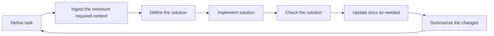

# Agentic Coding Patterns For Delivery Work

Agentic coding is easiest to present as a delivery loop: retrieve context, scope the next step, do the work, validate it, and update knowledge.

## The basic loop

**Coding task**

## Typical tools

| Area | Common tools |
|---|---|
| IDE | VS Code or another editor with agent support |
| Version control | Git |
| Package management | Tools for managing/installing dependencies (`uv`/`pip`, `npm`, `apm`, `nuget`) |
| **Agent harness** | Frameworks or tools to run and manage agents (`Copilot`, `Claude`, `Codex`) |

The point of listing tools is not to prescribe one stack. It is to show that agentic coding usually sits on top of a normal engineering toolchain rather than replacing it.

## Quality gates

Quality gates matter because they are deterministic. They give the agent and the human reviewer the same guard rails and the same definition of a passing change.

| Gate | Typical checks |
|---|---|
| Automated tests | Unit tests and integration tests, often through `pytest` or an equivalent test runner |
| Static analysis | Linters to drive code quality checks |

**Linters**
| Type | Purpose |
|---|---|
| Type checking | `pyright`, `mypy`, or language-specific type analyzers |
| Import/dependency rules | Import constraints and dependency analysis |
| Secret scanning | Detection of committed credentials or tokens |
| Formatting | Deterministic formatting tools such as `ruff format` or equivalent |

The main idea is simple: the agent should work inside the same validation system the team already knows and trusts.

## Optional roles

Not every task needs multiple agents. One agent may be enough depending on scope/complexity. Role splits help when scope is broad, task need to be focused, and/or permissions/tools should stay narrow.

**General roles**
| Role | Purpose |
|---|---|
| Orchestrator | Routes work to the next owner. |
| Explorer | Optional read-only discovery step for broad code surfaces. |
| Planner | Turns an ambiguous request into a bounded slice. |
| Implementation | Makes the code or config change. |
| Review | Looks for bugs, regressions, and scope drift. |
| Testing | Reproduces failures and runs validation. |
| Documentation | Updates durable reference material. |

**Specialized roles**
| Role | Purpose |
|---|---|
| Web Research | Confirms narrow external-product facts whenever planning, documentation, or implementation depend on them. |
| Git-Operator | Performs Git operations such as branching, committing, merging, and pushing changes. |
| Meta-Agent | Designs and implements agent prompts and workflows. Incorporates best practices and ensures consistency across agents. |
| Canvas-Operator | Performs operations on copilot canvas tools, such as creating, updating, or deleting elements. |
| Shell-Operator | Performs operations in the shell, such as running commands, scripts, or managing the environment. Further scoped to specific languages or environments. |
| Domain-Modeler | Specializes in understanding and designing domain-specific models, ensuring accurate representation and integration within the system. Variation of a planner. |
| Coder | Specializes in writing and modifying code, ensuring adherence to coding standards and best practices. Variation of an implementation role focused on a specific language. |
| Domain-Operator | Executes operations within a specific domain, ensuring that actions conform to domain rules and constraints. Has knowledge of the domain as needed. Variation of shell, API, SQL, or MCP operator scoped to a particular domain. |

## Prompt patterns

| Technique family | What it means in practice | Why it is useful |
|---|---|---|
| Task decomposition | Break a broad request into smaller bounded steps. | Reduces scope drift and makes validation easier. |
| Few-shot prompting | Provide a small number of examples that show the expected shape of the answer or workflow. | Helps the model match tone, structure, and task format more reliably. |
| Reasoning scaffolds | Ask for explicit intermediate structure such as steps, checks, comparisons, or decision criteria. | Useful for multi-step tasks, debugging, and tradeoff analysis. |
| Tool use | Let the model call search, diagnostics, terminals, tests, or other external tools. | Grounds the work in real repository state instead of guesswork. |
| Retrieval | Pull in relevant code, docs, plans, or prior decisions before acting. | Improves accuracy when important context lives outside the current prompt. |
| Planner-executor workflow | Separate task shaping from task execution. | Helps when the work is ambiguous, cross-cutting, or risky. |
| Review loop | Evaluate the output in a distinct pass before closing the task. | Catches regressions, missing tests, and weak assumptions. |

These techniques improve reliability by adding structure, context, and verification to the prompt-response loop.

## Docs as guidance

Teams often separate durable reference, workflow knowledge, and active planning.

| Documentation type | Typical role |
|---|---|
| Overview docs | User-facing overview and command index. |
| Durable reference docs | Stable design guidance, architecture notes, and shipped behavior. |
| Workflow notes | Team process, quality gates, and tool usage guidance. |
| Planning docs | Active planning, drafts, and unshipped ideas. |

This is useful because both people and agents have a stable place to look for settled facts.
Like code, as documents grow and evolve, they may need refactored to maintain clarity, accuracy, and relevance. Incorrect or stale documents can mislead both humans and agents, leading to errors and inefficiencies.

### Agent documents

#### Agents/copilot/agent-docs
- Keep documents relatively concise and focused.
- Include
  - Tools and commands that aren't easily guessed
  - Anything you do differently
  - Gotchas and common pitfalls
  - Boundaries/guard rails
- Instead of injecting lots of content, provide paths/references to other docs that can be read when needed. (Progressive disclosure)
- Large files should have a table of contents or an index to help navigate the content.

#### Skills
- For developing skills, do the task once with model and guide it. Use that experience to create agent documents capturing the steps, decisions, and any friction encountered during the process.

#### Hooks
- Use when you need to ensure that certain actions or conditions are consistently applied, such as enforcing policies, triggering automated workflows, or validating preconditions before executing tasks.

## Development process

### Legacy refactor or modernization

1. Build a reference set for the existing application.
2. Inventory the current system: database artifacts, modules, pages, integrations, workflows, and user-visible features.
3. Record design constraints, known pain points, and behaviors that must not regress.
4. Separate retained behavior from unwanted behavior, legacy debt, and features that should be removed.
5. Turn that inventory into a bounded migration backlog.

This gives the team a shared baseline before code generation or refactoring starts.

### New development or replacement build

1. Enumerate the existing features or expected capabilities.
2. Review that list with the project owner or domain owner.
3. Mark what must be retained, improved, dropped, and deferred.
4. Use these decisions to define the scope/requirements of the new system.
5. Translate the defined scope/requirements into actionable development tasks or slices.

This is often a practical way to start a replacement system because it turns a vague rewrite into an explicit scope decision.

### Shared delivery pattern

1. Gather the minimum context.
2. Convert the work into small, testable slices.
3. Validate each slice with deterministic quality gates.
4. Review changes as needed to ensure quality and build confidence.
5. Update documentation when behavior, ownership, or operating procedures changed.

## Further reading

The references below are useful if the audience wants more than a workflow overview.

| Topic | Reference | Why it matters |
|---|---|---|
| Prompting basics | [Prompt Engineering Guide](https://www.promptingguide.ai/) | A practical survey of prompting patterns and terminology. |
| Chain-of-thought prompting | [Chain-of-Thought Prompting Elicits Reasoning in Large Language Models](https://arxiv.org/abs/2201.11903) | Popularized the idea that structured intermediate reasoning can improve multi-step tasks. |
| Zero-shot reasoning | [Large Language Models are Zero-Shot Reasoners](https://arxiv.org/abs/2205.11916) | Shows that simple reasoning cues can improve performance even without examples. |
| ReAct | [ReAct: Synergizing Reasoning and Acting in Language Models](https://arxiv.org/abs/2210.03629) | Important for agent workflows that alternate between reasoning steps and external actions. |
| Self-consistency | [Self-Consistency Improves Chain of Thought Reasoning in Language Models](https://arxiv.org/abs/2203.11171) | Relevant when comparing multiple candidate reasoning paths before selecting an answer. |
| Retrieval-augmented generation | [Retrieval-Augmented Generation for Knowledge-Intensive NLP Tasks](https://arxiv.org/abs/2005.11401) | Useful when prompts should pull from external documentation or internal knowledge sources. |
| Tool use | [Toolformer: Language Models Can Teach Themselves to Use Tools](https://arxiv.org/abs/2302.04761) | Useful background for why tool-calling agents can outperform prompt-only approaches. |
| Multi-agent and role-based workflows | [AutoGen: Enabling Next-Gen LLM Applications via Multi-Agent Conversation](https://arxiv.org/abs/2308.08155) | Relevant when discussing planner, implementer, reviewer, and other specialized roles. |
| Software engineering agents | [SWE-bench: Can Language Models Resolve Real-World GitHub Issues?](https://arxiv.org/abs/2310.06770) | Grounds the discussion in a benchmark built around real maintenance tasks. |
| Agent benchmarking | [GAIA: a Benchmark for General AI Assistants](https://arxiv.org/abs/2311.12983) | Useful when discussing evaluation beyond toy prompt examples. |
| Mixture-of-experts models | [Outrageously Large Neural Networks: The Sparsely-Gated Mixture-of-Experts Layer](https://arxiv.org/abs/1701.06538) | Important background, but this is a model architecture topic rather than a prompting technique. |
