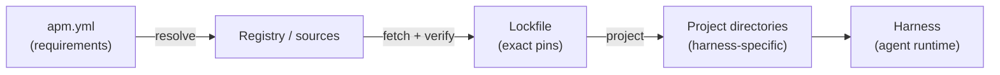
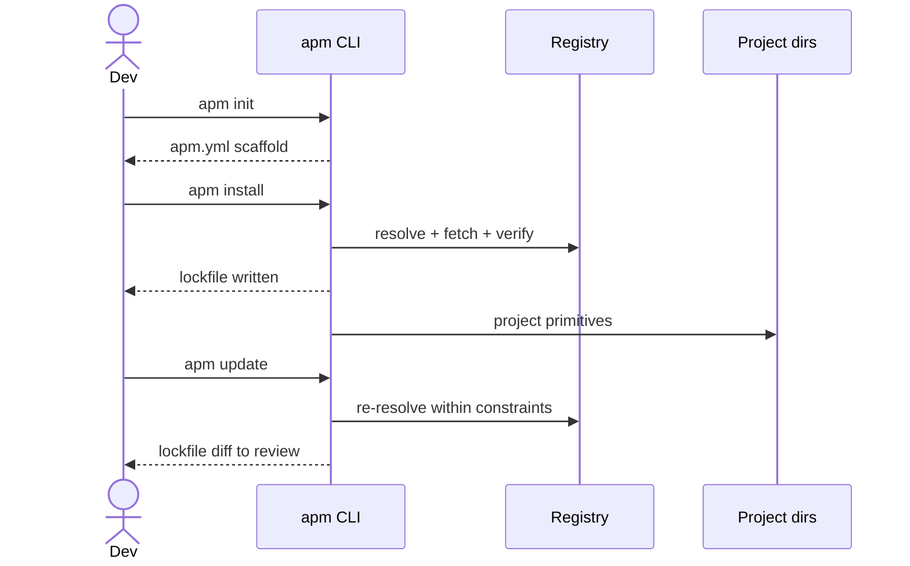

# Agent Package Manager (APM) Reference Guide

APM is a dependency manager for agent configuration. It fetches, verifies, locks, and projects agent assets into the directories a given harness expects.

**Audience:** developers who maintain agent setups, and AI agents that need to reason about the configuration they run under.

> **Verification note:** This guide is based on the project's core research summary, not on APM source in this repository. Nothing in Warchive installs or invokes APM yet. The command names `apm install`, `apm update`, and `apm list`, and the concepts below, come from that summary. The `apm.yml` field names, the `apm init` step, the lockfile name, and the registry layout are **illustrative**. Check them against the APM release you use before relying on them.

---

## Introduction & Vision

### The problem

Agent behavior is driven by files: prompts, instructions, skills, agent definitions, hooks, commands, plugins, and MCP server settings. Teams usually manage them by hand:

- Files are copied between repositories and drift apart.
- Each harness (VS Code Copilot, OpenCode, and others) expects a different directory layout.
- Nothing records which version of a prompt produced a given result.
- Updates are unreviewed, and rollbacks mean searching git history.

### The APM answer

APM treats these assets as **agent primitives** and manages them the way npm, Cargo, or pip manage code libraries.

| Ecosystem | Manifest | Unit of reuse |
|---|---|---|
| npm | `package.json` | JavaScript packages |
| Cargo | `Cargo.toml` | Rust crates |
| pip / uv | `pyproject.toml` / `requirements.txt` | Python distributions |
| **APM** | `apm.yml` | Agent primitives |

### Philosophy

APM is a **compiler of configurations, not an agent runtime**. It never runs an agent. It does four things, then gets out of the way:

1. **Fetch** primitives from a source.
2. **Verify** them.
3. **Lock** exact versions.
4. **Project** them into harness-specific directories.

---

## Key Concepts

### Primitives vs. harnesses

| Term | Meaning | Examples |
|---|---|---|
| **Primitive** | A reusable, harness-neutral unit of agent configuration. | prompts, skills, instructions, agents, hooks, commands, plugins, MCP servers |
| **Harness** | The tool that executes an agent and reads configuration from fixed locations. | VS Code Copilot, OpenCode |
| **Projection** | Writing a primitive into the layout a specific harness expects. | a skill placed in the harness's skills directory |

The same primitive can be projected to several harnesses. APM owns that mapping, so authors do not maintain parallel copies.

### Locking

A lockfile records the exact resolved version of every primitive, including transitive ones. It gives you:

- **Reproducibility:** the same lockfile gives the same agent behavior on any machine.
- **Auditability:** a diff on the lockfile shows exactly what changed in agent behavior.
- **Safe updates:** versions change only when you run `apm update`.

Commit both the manifest and the lockfile.

### Resolution

Resolution turns the loose requirements in `apm.yml` into concrete pins:

1. Read the requirements from the manifest.
2. Query the registry or source for matching versions.
3. Resolve transitive dependencies.
4. Write the pins to the lockfile.
5. Project the locked set into the project.

When a lockfile exists, `apm install` uses its pins instead of resolving again.

### Flow overview



---

## Manifest Specification (`apm.yml`)

`apm.yml` is the source of truth for the agents and capabilities a project requires. It declares requirements. The lockfile records what was actually resolved.

### Example

The field names below are illustrative.

```yaml
# apm.yml
name: warchive-agents
version: 0.1.0
description: Agent configuration for the Warchive control repository

dependencies:
  prompts:
    - example-org/review-prompts@^1.2.0
  skills:
    - example-org/security-review-skill@~2.0.1
  instructions:
    - example-org/python-style-instructions@1.4.0
  agents:
    - example-org/planner-agent@^0.3.0
  hooks:
    - example-org/pre-commit-checks@1.0.0
  commands:
    - example-org/release-commands@^1.0.0
  plugins: []
  mcp_servers:
    - example-org/docs-search-mcp@^0.5.0

targets:
  - vscode-copilot
  - opencode
```

### Field reference

| Field | Purpose |
|---|---|
| `name`, `version`, `description` | Identify the project or package. |
| `dependencies.<primitive-type>` | Required primitives, grouped by type, each with a version constraint. |
| `targets` | Harnesses to project into. |

### Version constraints

The example uses npm-style constraints: `1.4.0` is exact, `^1.2.0` allows compatible minor and patch updates, and `~2.0.1` allows patch updates only. Confirm the constraint syntax your APM version supports.

### Manifest and lockfile

| | `apm.yml` | Lockfile |
|---|---|---|
| Written by | Humans, or the CLI on request | The CLI |
| Contains | Requirements and ranges | Exact resolved versions |
| Edited by hand | Yes | No |
| Committed | Yes | Yes |

---

## Developer Workflow



### Step 1: Initialize

Create the manifest in the project root. The command is illustrative, and you can also write `apm.yml` by hand.

```bash
apm init
```

### Step 2: Declare dependencies

Edit `apm.yml` and list the primitives and targets the project needs (see section 3).

### Step 3: Install

```bash
apm install
```

- Without a lockfile, APM resolves, verifies, writes the lockfile, and projects the primitives.
- With a lockfile, APM reproduces exactly the locked set.

Commit the manifest and the lockfile.

### Step 4: Inspect

```bash
apm list
```

Shows the primitives installed in the project.

### Step 5: Update

```bash
apm update
```

Re-resolves within the manifest constraints and refreshes the lockfile. Review the lockfile diff like any dependency bump, and test the agent's behavior before merging.

### Good practices

- Treat projected directories as build output. Change the source primitive, then reinstall, instead of hand-editing projected files.
- Review third-party primitives before adding them. Hooks, plugins, and MCP servers can execute code or reach external systems. See [codebase-security-and-malware-review.md](../../../research/codebase-security-and-malware-review.md).
- Pin exact versions for high-risk primitive types.

---

## Agentic Capabilities

Agents benefit from APM in two ways.

### Stable behavior across harnesses

Because the lockfile pins every primitive, an agent sees the same instructions, skills, and tools whether it runs in an editor, a CLI harness, or CI. Behavior differences then come from the model or the task, not from drifted configuration.

### Discovering context and tools

An agent can inspect its own configuration through these sources:

| Source | What the agent learns |
|---|---|
| `apm.yml` | Which capabilities the project intends to have. |
| Lockfile | The exact versions in effect, which is useful for reproducing or reporting an issue. |
| `apm list` | The currently installed primitives. |
| Projected harness directories | The skills, instructions, and agents loaded at runtime. |

### Guidance for agents

- Read `apm.yml` and the lockfile before assuming a skill or tool exists.
- Propose changes to dependencies as edits to `apm.yml`, not as hand edits to projected files.
- Do not run `apm update` unprompted. It changes agent behavior, so it needs human review.
- Quote the locked version when reporting problems with a primitive.

---

## Registry & Discovery

Primitives are sourced from registries or sources that APM can fetch from. The exact source types, such as a hosted registry, git repositories, or local paths, depend on the APM release.

| Concern | Behavior |
|---|---|
| **Sourcing** | Requirements in `apm.yml` are matched against available versions at the source. |
| **Verification** | Fetched content is verified before it is locked and projected. |
| **Pinning** | The lockfile records the resolved version of each primitive. |
| **Discovery** | Use the registry's search or listing tools, or a source repository, to find primitives, then add them to `apm.yml`. |

Prefer sources you control or trust. A primitive's content becomes part of your agent's context, so treat it as executable influence.

---

## Installation

The [0.35.0 installation guide](https://raw.githubusercontent.com/microsoft/apm/v0.35.0/docs/src/content/docs/getting-started/installation.md) lists Git for dependency management; Python 3.10+ is needed only for pip or source installation. Check available versions in PowerShell:

```powershell
apm --version
git --version
```

### Windows

If APM is missing, upstream lists this Windows installation command:

```powershell
irm https://aka.ms/apm-windows | iex
```

**Warning:** this downloads and executes remote code. Inspect the downloaded script and its source before deciding whether to run it. The command above is documentation, not an instruction to install APM as part of this guide.

### Package source and initialization

According to the [package anatomy](https://github.com/microsoft/apm/blob/v0.35.0/docs/src/content/docs/concepts/package-anatomy.md), an APM package's canonical source includes a project `apm.yml` and primitives under `.apm/`, for example:

```text
apm.yml
.apm/
  skills/<name>/SKILL.md
  agents/<name>.agent.md
  instructions/<name>.instructions.md
```

Skill directories are included as a whole, including their scripts and assets. Existing `.github` locations are deployment or project configuration; do not assume they are automatically packaged. [Package-relative links](https://github.com/microsoft/apm/blob/v0.35.0/docs/src/content/docs/producer/package-relative-links.md) are rewritten for certain primitive types, while skills retain their internal structure. Links outside the package, including links to external docs, may break after transfer; test them in the consumer.

In an isolated pilot project, [`apm init [PROJECT_NAME] [OPTIONS]`](https://microsoft.github.io/apm/reference/cli/init/) initializes a package. `apm init --yes` creates `apm.yml` in the current project; ordinary initialization does not create an `.apm` directory. Check `apm init --help` against the installed version before use. Follow upstream for manifest fields rather than copying an invented schema.

### Local bundle and disposable consumer

The following is a prospective **offline bundle transfer**, not a dependency declaration or public package. No registry or network publishing is needed for a local bundle. In the pilot's `apm.yml`, explicitly set `dependencies: {}` for a local-assets-only bundle: omitted or null dependencies produce no bundle. Dependencies can otherwise be bundled; development dependencies are excluded. See the [pack reference](https://microsoft.github.io/apm/reference/cli/pack/) and [bundle guide](https://microsoft.github.io/apm/producer/pack-a-bundle/).

From the pilot project root, after preparing its source and manifest:

```powershell
apm pack --format apm --archive
```

The default pack format is plugin, so explicitly request `apm` format for unpacking. This command makes a legacy APM zip, normally `build/<package-name>-<version>.zip`. From that **same pilot root**, with a separate, precreated disposable `consumer` directory, substitute the actual archive filename for the example below:

```powershell
apm unpack '.\build\my-package-1.0.0.zip' --output '.\consumer' --dry-run
apm unpack '.\build\my-package-1.0.0.zip' --output '.\consumer'
```

Review the dry run before unpacking. As documented in the [unpack reference](https://microsoft.github.io/apm/reference/cli/unpack/), the archive path is positional and `--output` selects the destination. Unpacking is additive but **overwrites collisions**; it does not delete unrelated files, and no backup is documented. Never test against a live workspace. Validate the resulting files, links, and skill assets in the disposable consumer before using them elsewhere.

A Git-based remote source is a separate alternative to transferring this local archive. Private remote sources may require Git credentials; a local-only bundle does not require registry credentials. See [authentication](https://microsoft.github.io/apm/consumer/authentication/). Do not assume a local Git or `file://` dependency syntax from this bundle workflow.

### Locking and review

The [lockfile specification](https://microsoft.github.io/apm/reference/lockfile-spec/) describes `apm.lock.yaml`, including resolved commits and content hashes. These records help review and verify resolved dependencies; a lockfile alone does not guarantee offline availability, identical agent behavior, or deterministic results across environments. Review dependency and lockfile changes and test the resulting agent behavior. Do not update dependencies or execute bundled scripts without appropriate review.

## 7. Quick Reference

### Commands

| Command | Purpose |
|---|---|
| `apm init` *(illustrative)* | Scaffold `apm.yml`. |
| `apm install` | Resolve, fetch, verify, lock, and project primitives. Honors an existing lockfile. |
| `apm update` | Re-resolve within the manifest constraints and refresh the lockfile. |
| `apm list` | List installed primitives. |

### Manifest fields *(illustrative)*

| Field | Purpose |
|---|---|
| `name` / `version` / `description` | Project identity. |
| `dependencies.prompts` | Reusable prompts. |
| `dependencies.skills` | Skills. |
| `dependencies.instructions` | Instruction files. |
| `dependencies.agents` | Agent definitions. |
| `dependencies.hooks` | Lifecycle hooks. |
| `dependencies.commands` | Commands. |
| `dependencies.plugins` | Plugins. |
| `dependencies.mcp_servers` | MCP server configurations. |
| `targets` | Harnesses to project into. |

### Related Warchive references

- [vscode-copilot-agent-customization-reference.md](vscode-copilot-agent-customization-reference.md): the VS Code Copilot customization surfaces APM would project into.
- [opencode-agent-configuration-reference.md](opencode-agent-configuration-reference.md): the OpenCode configuration surfaces APM would project into.
